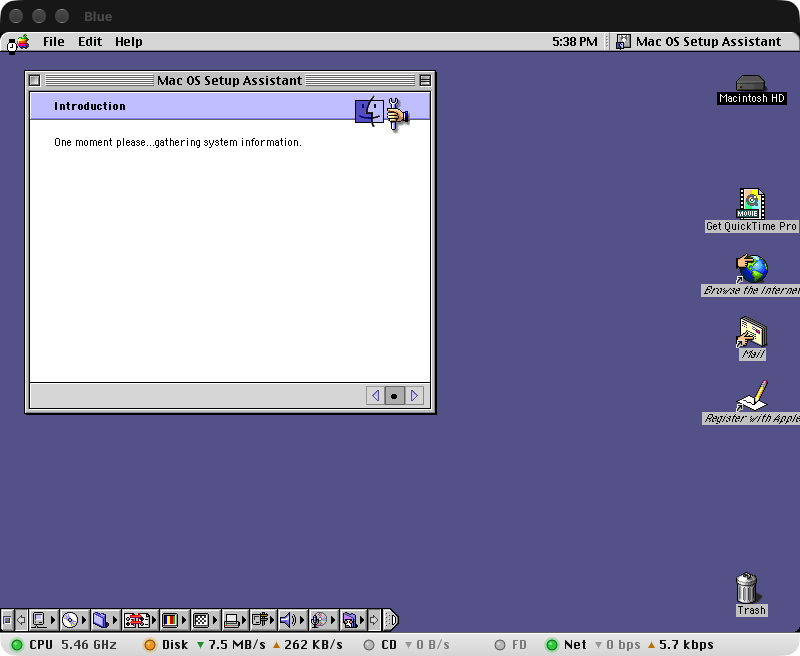
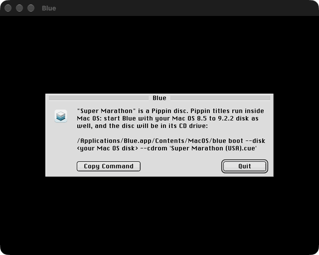

<p align="center">
  
</p>

<h1 align="center">Blue</h1>

<p align="center">
  <strong>A blazing-fast, feature-rich Mac OS 8, 9 &amp; Pippin runtime.</strong>
</p>

<p align="center">
  <a href="https://blue.tx.au/">Website</a> ·
  <a href="https://github.com/mcbridet/Blue/releases/latest">Download</a> ·
  <a href="#quick-start">Quick start</a> ·
  <a href="#using-blue">Using Blue</a> ·
  <a href="#troubleshooting-and-faq">FAQ</a> ·
  <a href="#documentation">Documentation</a> ·
  <a href="#license">License</a>
</p>

<p align="center">
  <a href="https://github.com/mcbridet/Blue/actions/workflows/ci.yml"></a>
  <a href="https://github.com/mcbridet/Blue/releases/latest"></a>
  
  
  <a href="LICENSE"></a>
</p>

<p align="center">
  
</p>

## What Blue is

Blue runs classic Mac OS, from version 8.5 to 9.2.2, on a Mac or a Linux
PC of today. It doesn't emulate a whole Power Mac: it replaces the lowest
layer of Mac OS, the NanoKernel, with a native program, and runs
everything above it, Apple's own code, unmodified. To Mac OS, the machine
looks like an original iMac from 1998.

You bring the Mac OS: the Mac starts up from a Mac OS CD image, Mac OS's
own installer puts it on a disk image, and from then on the Mac starts up
from that disk, in a window on your desktop.

### Highlights

- **Mac OS 8.5 to 9.2.2,** unmodified, from their CDs or installed on a disk
  image. Blue starts the "Mac OS ROM" file from the startup disk, as the
  original iMac's firmware does.
- **Fast:** a PowerPC JIT on Apple silicon, ARM64 Linux and x86-64 (Intel
  from 2013, AMD from 2015), many times a real G3's speed.
- **3D:** QuickDraw 3D and RAVE through an engine games see as an ATI Rage
  128, and Mac OS 9's OpenGL through Blue's own libraries, drawn on the GPU
  (over Metal on Apple silicon) or in software.
- **The rest of a Mac:** sound and CD audio, networking through your
  connection, the internal modem (its calls go over the internet), a
  folder of yours as a disk, the clipboard shared both ways,
  and disk, CD (`.iso`, `.toast`, `.cue`/`.bin`, `.nrg`, `.mds`, `.ccd`,
  `.chd`, `.dmg`) and floppy images you drop on the window.
- **Game controllers:** Xbox, PlayStation, Switch and other pads play as
  the keyboard and mouse, as a Pippin's AppleJack, and as game controllers
  of their own in games that use InputSprocket.
- **Guest tools,** offered once the Finder is up: the screen follows the
  window's size, the clipboard is shared, and the 3D engine, OpenGL, game
  controllers for InputSprocket and a library for Bandai Pippin titles are
  installed.
- **Reproducible runs** for testing and debugging: in instruction time, a run
  is the same every time, down to the instruction.

### How it works

On a real Power Mac, only the NanoKernel runs in the processor's
supervisor mode. The 68k emulator, the Toolbox, applications and drivers
all run in user mode and reach the kernel through a small interface. Blue
keeps all of that Apple code as it is and supplies everything below the
interface itself:

```
68k apps, 68k Toolbox code    → Apple's own 68k emulator (from the ROM, unchanged)
PPC apps, Toolbox, drivers    → Blue's user-mode PowerPC JIT and interpreter
══════ NanoKernel interface: kernel calls (twi, sc), exceptions, interrupts ══════
Native kernel + an iMac's devices + drivers + loader   ← Blue, portable C
macOS and Linux hosts, AArch64 and x86-64
```

[docs/architecture.md](docs/architecture.md) tells the whole story.

### How Blue compares

SheepShaver and QEMU are the long-standing ways to run classic Mac OS on
today's computers, and Apple's own Classic environment once ran Mac OS 9
inside Mac OS X. Blue owes a lot to the first two (see
[Acknowledgements](#acknowledgements)). Here's how it stands beside all three:

| | Blue | SheepShaver | QEMU | Classic, in Mac OS X |
|---|---|---|---|---|
| **Mac OS** | 8.5 to 9.2.2 | 7.5.3 to 9.0.4 | 9.0 to 9.2.2, and Mac OS X 10.0 to 10.5 | 9.1 to 9.2.2 |
| **Runs on** | macOS 11 and later, and Linux: Apple silicon, ARM64 and x86-64 | macOS, Linux and Windows | macOS, Linux and Windows | PowerPC Macs, with Mac OS X 10.0 to 10.4 |
| **How** | Apple's code, unmodified, on a native kernel in place of the NanoKernel | Apple's code on a patched ROM, with a kernel of its own | A whole Power Mac emulated, firmware and all | Mac OS 9 as a program in Mac OS X, on a real PowerPC |
| **Speed** | A JIT on every host: about 18 times a Power Mac G3/300 in MacBench 5's processor test, on an Apple M5 | A JIT on Intel and AMD; none on Apple silicon | A JIT, with every device and the memory management unit emulated | The PowerPC's own, up to a Power Mac G5 |
| **What you need** | A Mac OS CD or disk image | A Mac OS CD or disk image, and a ROM file found elsewhere | A Mac OS CD or disk image | Mac OS 9 installed beside Mac OS X |
| **3D** | QuickDraw 3D, RAVE (as an ATI Rage 128) and OpenGL, drawn on your GPU | Software only | Software only | Programs that draw straight to the screen or the hardware often fail |
| **Restart and Startup Disk** | Both work | Restarting can freeze or crash it; Startup Disk doesn't work | Neither works | Mac OS X's own |
| **Screen** | Follows the window's size, scaled to suit your display | A fixed size, set in its settings | Set in Mac OS's Monitors control panel | Mac OS 9's windows among Mac OS X's |
| **Sound** | Yes, with CD audio from most kinds of CD image | Yes, with CD audio from `.cue`/`.bin` images | Only in separate experimental builds | Yes |
| **Sound input** | Not yet | No | No | Yes |
| **Disk images** | Dropped on the window or inserted from the menu: CD images in most formats, compressed `.dmg` and Disk Copy images, floppies | Uncompressed images, and one at a time dropped in as a CD | Raw and QEMU's own formats, changed from a menu | Mac OS X's |
| **Shared folders** | A folder of yours as a disk, its changes written back when Mac OS shuts down or puts it away, and offered again with yours | A folder as a live disk, though programs can't run from it | Separate experimental drivers | Mac OS X's disks, directly |
| **Networking** | TCP/IP through its NAT; no port forwarding yet | TCP/IP through its NAT, with port forwarding; AppleTalk with extra setup, on some hosts | TCP/IP through its NAT, with port forwarding; AppleTalk through bridged networking, run as root | Mac OS X's, AppleTalk included |
| **Modem** | The iMac's internal modem, its calls going over the internet | The modem and printer ports passed to the host's serial ports; no modem of its own | A host serial port, through an emulated USB serial adapter and FTDI's driver; no modem of its own | Mac OS X's dial-up connection, for internet programs; terminal and fax programs can't use the modem |
| **Game controllers** | Gamepads, as keys or through InputSprocket | No | A USB gamepad, passed through | Unreliable |
| **Pippin titles** | Yes | No | No | No |

SheepShaver also runs System 7.5 to Mac OS 8.1, given an Old World ROM.
Blue's other gaps, such as USB devices, are listed under
[What isn't there](#what-isnt-there).

## Download and install

| Platform | Download |
|---|---|
| macOS, Apple silicon | [Blue-arm64.dmg](https://github.com/mcbridet/Blue/releases/latest/download/Blue-arm64.dmg) |
| macOS, Intel | [Blue-x86_64.dmg](https://github.com/mcbridet/Blue/releases/latest/download/Blue-x86_64.dmg) |
| Linux x86-64 | [Blue-x86_64.AppImage](https://github.com/mcbridet/Blue/releases/latest/download/Blue-x86_64.AppImage) |
| Linux AArch64 | [Blue-aarch64.AppImage](https://github.com/mcbridet/Blue/releases/latest/download/Blue-aarch64.AppImage) |

Each [release](https://github.com/mcbridet/Blue/releases) also has a
`SHA256SUMS` file with the downloads' checksums, the source code it was
built from, and `Blue-third-party-sources.tar.gz`: the exact sources of
the libraries the packages carry (SDL2, libslirp and GLib, with what they
need), as [THIRD-PARTY-NOTICES.md](THIRD-PARTY-NOTICES.md) describes.

### macOS

Blue needs macOS 11 (Big Sur) or later. Open the disk image for your Mac
(`Blue-arm64.dmg` for Apple silicon, `Blue-x86_64.dmg` for Intel) and drag
Blue to Applications.

The first time, macOS won't open Blue by double-clicking it. Blue is
signed ad hoc rather than by a registered Apple developer, and isn't
notarised, so macOS asks you to confirm it once:

- On macOS 14 and earlier, right-click (or Control-click) Blue in
  Applications and choose Open, then Open again.
- On macOS 15 and later, try to open it once, then go to System Settings >
  Privacy & Security, scroll down, and click Open Anyway next to the note
  about Blue.

After that it opens normally. If you prefer Terminal,
`xattr -dr com.apple.quarantine /Applications/Blue.app` does the same.

Blue runs from Terminal for now, as `/Applications/Blue.app/Contents/MacOS/blue`.
To type just `blue`, make a link to it in a folder on your `PATH`, for
example: `ln -s /Applications/Blue.app/Contents/MacOS/blue /usr/local/bin/blue`.

### Linux

The AppImages run on Linux with glibc 2.35 or later (Ubuntu 22.04, Debian
12, Fedora 36 and later): `Blue-x86_64.AppImage` for x86-64 PCs,
`Blue-aarch64.AppImage` for ARM64. Make yours executable, then run it as
Blue itself:

```sh
chmod +x Blue-x86_64.AppImage
./Blue-x86_64.AppImage --version
```

An AppImage mounts itself with FUSE, so it needs `fusermount` (the `fuse`
or `fuse3` package, which most desktops already have). Without FUSE, in a
container for example, add `--appimage-extract-and-run` before Blue's own
arguments: the AppImage then unpacks itself into a temporary folder each
time. Or unpack it once with `--appimage-extract` and run
`squashfs-root/AppRun` instead. AppImage integration tools, such as
AppImageLauncher and Gear Lever, can add Blue to your desktop's
applications.

### From source

You can also build Blue yourself: see
[Building from source](#building-from-source).

### Opening Blue from the desktop

If you double-click Blue.app or an AppImage, Blue shows a small window
rather than a Mac. For now, Blue is started from the command line, where
you tell it which disks and CDs to use. The window shows the command for
your copy of Blue, with a button that copies it, ready to paste into
Terminal.

A launcher is coming: a window for choosing the disks, CDs, memory and
shared folder, which remembers them between launches (see
[docs/roadmap.md](docs/roadmap.md)).

<p align="center">
  
</p>

## Quick start

Here's how to install Mac OS on a disk image and start it up. In the
commands below, `blue` stands for Blue's command:

| You have | Type this for `blue` |
|---|---|
| Blue.app on macOS | `/Applications/Blue.app/Contents/MacOS/blue` |
| An AppImage on Linux | `./Blue-x86_64.AppImage` (or `./Blue-aarch64.AppImage`) |
| Your own build | `build/blue` |

### What you need

- **A Mac OS CD image,** of version 8.5 to 9.2.2 (see
  [Compatibility](#mac-os-versions)): an `.iso`, `.toast`, `.cdr`, `.img`
  or `.dmg` file, or a `.cue` sheet with its `.bin` files (or another kind
  of CD image: see [Images Blue takes](#disks-cds-and-floppies)). Blue
  includes no Apple software, and needs no separate ROM file: it uses the
  "Mac OS ROM" file on the CD. To make an image of a CD you own, use Disk
  Utility on a Mac (File > New Image > Image from the disc, in the "DVD/CD
  master" format, which makes a `.cdr`), or `dd` on Linux.
- **About 2 GB of free space** for the Mac's disk.

### 1. Make a disk

```sh
blue disk create hd.img 2G "Macintosh HD"
```

This makes `hd.img`, a 2 GB disk image holding an empty Mac OS Standard
(HFS) volume called Macintosh HD. On most file systems the file only takes
up the space Mac OS fills. Blue won't overwrite a file that's already
there.

### 2. Install Mac OS

```sh
blue boot --disk hd.img --cdrom macos.iso --nvram blue.nvram
```

This starts the Mac in a window, running in real time, with the new disk
and the CD attached:

- `--disk hd.img` attaches the disk image, which Mac OS can write to.
- `--cdrom macos.iso` puts the CD image in a CD-ROM drive.
- `--nvram blue.nvram` keeps the Mac's settings in a file (see
  [below](#keeping-your-settings)).

Blue starts up from the first drive that has a System Folder with a "Mac
OS ROM" file in it, in the order you gave them. The new disk is empty, so
the Mac starts up from the CD.

**Most Mac OS CDs:** open "Mac OS Install" on the CD and follow it,
with Macintosh HD as the destination. The installation takes a few
minutes at most.

**Restore CDs,** which install with Apple Software Restore instead:
open Apple Software Restore from the CD's window. Click Switch Disk until
the destination is Macintosh HD, then Restore, and OK. This erases the
disk and copies Mac OS onto it (the disk then takes the restored
system's name). When it's done, click **Quit**, so that the Finder can
set the new disk up.
Drive Setup may open too, and list no drives: that's expected, and you
don't need it.

When the installation is over, choose **Shut Down** from Mac OS's Special
menu. Blue quits when the Mac turns itself off.

### 3. Start up from the disk

```sh
blue boot --disk hd.img --nvram blue.nvram
```

The disk now has a System Folder, so the Mac starts up from it. The first
time, Mac OS Setup Assistant asks a few questions. (While it's open, it
keeps one of your processor's cores busy, as it kept a real Mac's
processor busy; once it's finished, Blue goes back to resting while Mac OS
is idle.)

You can leave the CD attached if you like: the disk comes first on the
command line, so it stays the startup disk.

### 4. Install the guest tools

Once the Finder is up, Blue offers to install its guest tools on the
startup disk. Click **Install and Restart**: Mac OS writes the tools into
its Extensions folder and restarts, and from then on the screen follows
the window's size, the clipboard is shared, the scroll wheel scrolls, and
3D games are accelerated. See [The guest tools](#the-guest-tools).

### Keeping your settings

`--nvram FILE` keeps the Mac's NVRAM in a file: the settings Mac OS keeps
in parameter RAM, and the startup disk chosen in the Startup Disk control
panel. Without it, the Mac starts each time with blank settings. Use the
same file every time you start a particular Mac, and give each
installation its own. Mac OS 9.1 and later write their settings when they
shut down or restart, so shut down from Mac OS to keep changes.

Blue keeps its own settings, those you choose in its menu, in a settings
file: for now, your [game controllers' mappings](#game-controllers). It's
in `~/Library/Application Support/Blue/settings.ini` on macOS, and
`~/.config/blue/settings.ini` on Linux (or in `$XDG_CONFIG_HOME/blue/`).
It's plain text, `name = value` lines under a `[section]`, which you can
read and edit (with Blue closed): `[controller]` has the mapping for all
controllers, a line for each button, stick and trigger (`a = Return`,
`lefttrigger = Control-Click`, `rightstickmode = Mouse`), and
`[controller ID]` sections a kind of controller's own, by its SDL GUID.
Blue writes it whole each time something changes, to a new file it then
puts in the old one's place. Runs without a window, in instruction time
or with an input script leave it alone; `--settings FILE` uses another
file (in any run), and `--settings none` none.

## Using Blue

### The window

The window shows the Mac's screen, with Blue's status bar below it. The
Mac runs in real time while the window is open, and rests when Mac OS is
idle.

To finish, shut down from Mac OS (Special > Shut Down): applications get
to save their work, the shared folder's changes are written back, and
Blue quits when the Mac turns itself off.

Closing the window, or quitting Blue (Quit Blue in the menu bar, Quit in
the Dock, or logging out of macOS), asks first while Mac OS is running:

- **Shut Down** (the default, Return) presses the Mac's power key, as
  [Shut down…](#blues-menu-f12) in Blue's menu does: Mac OS asks whether to
  shut down, applications may ask to save their work, and Blue quits when
  the Mac turns itself off.
- **Turn Off** quits at once, like pulling the plug: anything unsaved in
  Mac OS is lost, and a shared folder's changes aren't written back. NVRAM
  is kept.
- **Cancel** (Esc) goes back to the Mac.

Asking again while Blue is asking changes nothing: choose Turn Off to
quit at once. Before Mac OS has started up (until the Finder is up),
there's nothing to lose, and Blue quits straight away. Interrupting Blue
in its terminal (Control-C) still stops it at once.

### Blue's menu (F12)

<p align="center">
  
</p>

Press **F12** to open Blue's menu. The Mac pauses while the menu is open;
F12 or Esc closes it again.

- **Resume** closes the menu.
- **Restart** restarts the Mac at once, like its reset button: anything
  unsaved in Mac OS is lost.
- **Shut down…** presses the Mac's power key, so Mac OS asks whether to
  shut down, and does it properly if you say so.
- **Turn off** turns the Mac off at once, like its power switch, for a Mac
  that has stopped responding. NVRAM is kept.
- **Install Guest Tools…** offers the [guest tools](#the-guest-tools)
  again, whenever there's something to install.
- **The drives:** each floppy and CD-ROM drive shows what's in it, with
  **Eject** and **Insert…** buttons (see
  [Disks, CDs and floppies](#disks-cds-and-floppies)).
- **Refresh "Folder"** brings changes across with the
  [shared folder](#the-shared-folder) now: Mac OS puts its disk away, what
  Mac OS changed goes to your folder, and the disk comes back with what's
  in your folder. The menu says when the folder has changed on your
  computer.
- **Screenshot** saves the Mac's screen as a PNG on your Desktop.
- **Fullscreen** fills your display with the Mac.
- **Scale** sets how big the Mac's pixels are (see
  [Screen size and scale](#screen-size-and-scale)).
- **Status bar** shows or hides the status bar.
- **Capture the mouse** sets whether the mouse is captured while Mac OS
  hides its pointer, as games do (see [Keyboard and mouse](#keyboard-and-mouse)).
- **Controllers** lists the game controllers connected, and which mapping
  they follow; its checkbox turns them off, and **Mappings…** sets what
  their buttons, sticks and triggers do (see
  [Game controllers](#game-controllers)).
- **Modem** says what the [modem](#the-modem) is doing, and **Hang Up**
  ends its call.

While the menu is open, the Mac's clock stops, so it's behind by that
much afterwards.

### The status bar

The status bar has a light for each of the Mac's parts, and what each is
doing:

- **CPU** glows green as the Mac works and soft blue while it rests, and
  shows the Mac's speed, as the clock rate of a G3 that would keep up.
- **Disk**, **CD-ROM** and **Floppy** light up as they read (green) and
  write (amber), with how many bytes a second they move.
- **Network** lights up as the Mac sends and receives, in bits a second.

A dimmed light means there's no such device, and "F12: menu" on the
right is a reminder of where the menu is. `--no-status-bar` starts
without the status bar; the menu brings it back.

### The guest tools

Some things only code inside Mac OS can do, so Blue comes with guest tools
that it installs there for you:

| Guest tool | What it does |
|---|---|
| Blue Enhancements | The screen follows the window's size, the clipboard is shared with your computer, and the scroll wheel scrolls the window under the pointer. |
| Blue 3D Engine | Accelerates QuickDraw 3D and RAVE games, which see an ATI Rage 128. |
| Blue OpenGL Library, Memory and Utility | OpenGL for Mac OS 9 games, drawn on your GPU. |
| Blue Pippin Library | Lets Bandai Pippin titles run, and game controllers play them as the Pippin's AppleJack (see [Pippin titles](#pippin-titles)). |
| Blue Game Controllers | Game controllers in games that use InputSprocket, as themselves, set up in each game's own controls dialog (see [Game controllers](#game-controllers)). |

When the Finder is up and a tool is missing, or comes from another
version of Blue, Blue offers to install them, over the Mac's screen:

<p align="center">
  
</p>

- **Install and Restart** (or **Update and Restart**) writes the tools
  into the System Folder's Extensions folder and restarts Mac OS, as
  Special > Restart does: applications may ask to save their work first.
  CDs and floppies stay in their drives.
- **Not Now** leaves them for now: Blue asks again the next time Mac OS
  starts up.
- **Don't Ask Again** stops the offer for that disk. Blue remembers it in
  a "Blue Preferences" file in the disk's Preferences folder; Install
  Guest Tools… in Blue's menu still offers them.

Mac OS 9 comes with OpenGL libraries of Apple's under the same names, so
when Blue's are installed, Apple's move to Extensions (Disabled). If you
delete Blue's later, Blue offers to put Apple's back.

Blue doesn't offer the tools when the startup disk is a CD, or can't be
written. To install them by hand instead, make a disk of them with
`blue tools create tools.img`, attach it with `--cdrom tools.img`, drag
its files onto the System Folder, and restart.

### Screen size and scale

With Blue Enhancements installed, the Mac's screen follows the window:
resize the window, or make it full screen, and Mac OS changes its
resolution to fill it once you let go. Without it, the screen keeps the
resolution chosen in Mac OS's Monitors & Sound control panel (640 × 480 to
1280 × 1024), and the window scales it to fit.

The **scale** is how many of your display's pixels make one of the Mac's,
from 1 to 4. **Auto**, the default, makes Mac OS about as big on your
display as on a 1999 Mac's screen (about 80 pixels to the inch), from
your display's size and resolution: 1× on a typical 27-inch 1440p
display, 2× on a 4K one, 3× on a 5K iMac or a 14-inch MacBook Pro. If
Mac OS looks too small or too big, choose another scale in the menu, or
start with `--scale 2` (or `auto`, `1`, `3`, `4`). `--integer-scale` keeps
the picture crisp, with a border if need be, where the window would
otherwise scale the screen by a fraction.

### Keyboard and mouse

| Mac key | On a Mac keyboard | On a PC keyboard |
|---|---|---|
| Command (⌘) | Command | Windows or Super |
| Option (⌥) | Option | Alt |
| Control | Control | Ctrl |

Command-key shortcuts go to Mac OS, as on a Mac: Command-Q quits the Mac
OS application in front, Command-W closes its window, and so on. Blue
takes none of them, on macOS too: its menu bar has just About Blue, Hide
Blue and Quit Blue, without shortcuts. (macOS keeps a few for itself,
such as Command-Tab, Command-Space and its screenshot keys.) F12 is
Blue's: it opens the menu, and Mac OS never sees it. (On a Mac laptop,
you may need to hold fn as you press F12.)

The Mac has a one-button mouse: the left button is its button, and the
right button Control-clicks, for contextual menus. Mac OS 8 and 9 didn't
know scroll wheels, so with Blue Enhancements (one of the
[guest tools](#the-guest-tools)) the wheel, and a trackpad's two-finger
scrolling, scroll as the tools of the time made them: the window under
the pointer, in the application in front, scrolls by its scroll bar, as
clicks on the scroll bar's arrows would scroll it, a line for each step
of the wheel (sideways too). Where there's no scroll bar under the
pointer (the desktop, a game), and without Blue Enhancements, the wheel
presses the arrow keys instead, a press for each line. In a game that has
the mouse (below), the right button and the wheel do nothing.

The Mac's pointer follows yours. When Mac OS hides its pointer for a
moment, as games do, Blue captures the mouse, so that its movements go to
the game; the window's title says so. Press **Control-Option**
(Ctrl+Alt) to get your pointer back, and click in the window to capture
it again. Capture the mouse in the menu turns this off.

### Game controllers

Game controllers (Xbox, PlayStation, Switch and other pads SDL knows,
several at once, plugged in and out as you like) work in the window, as
the Mac's keyboard and mouse. Their buttons are known by where they sit:
A is the bottom face button, B the right one, X the left and Y the top,
whatever the pad's labels say.

| On the pad | In Mac OS |
|---|---|
| D-pad, left stick | The arrow keys |
| A | Return |
| B | Command-period (Cancel) |
| X | Space |
| Y | Tab |
| Start | Esc |
| Back (Select, View, Minus) | Command, held |
| Left and right shoulder | Shift and Option, held |
| Right stick | Moves the mouse (pressed: clicks) |
| Right trigger | Clicks |
| Left trigger | Control-clicks (a contextual menu) |

That's Blue's mapping, and you can change it: **Mappings…** under
Controllers in Blue's menu (F12) shows what each button, stick and
trigger does, for all controllers, or for a kind of controller plugged
in, which can have a mapping of its own. Click one to choose a key
(**Press a Key…**, then the key, with Command, Shift, Option or Control
held for a key with modifiers; a modifier alone is held as long as the
button is), a click (with modifiers too), a double-click, **Click Lock**
(the mouse button stays down until pressed again) or nothing; each stick
is either the mouse or four keys of its own. **Restore Defaults** puts
Blue's mapping back. Blue keeps your mappings between runs, in its
[settings file](#keeping-your-settings).

While a [Pippin title](#pippin-titles) runs in front, the pad is the
Pippin's AppleJack controller instead, and the title's own mapping of its
buttons applies, as on a Pippin: the D-pad and left stick are its D-pad;
A, B, X and Y its red, green, yellow and blue buttons; the shoulders and
triggers its left and right fire buttons; Back, Guide (Home, PS) and
Start its three buttons below; and the right stick its trackball. With
two pads plugged in, the title has two AppleJacks, as a Pippin with two
controllers had: the second pad is the second, for titles that play two
on one Pippin. Your own mappings are for Mac OS, not for Pippin titles,
which have theirs.

Games that use InputSprocket (Apple Game Sprockets' input library, which
most Mac action games of the late 1990s do)
get each pad as a game controller of its own, through Blue Game
Controllers, one of the [guest tools](#the-guest-tools). The game sets it
up as it would a joystick: shooters move and slide with the left stick,
turn and look with the right (as with the mouse), fire with the right
trigger and jump with A, and the game's own controls dialog (often under
Options) shows the pad, its buttons, sticks
and triggers by name, to change what each does; the game keeps your
choices. While the game is in front, the controls it uses do only that;
the rest keep the mapping above, so Start is still Esc, for its menus.
InputSprocket itself is Apple's, not Blue's: games that use it come with
it, to install with them.

**Controllers** in Blue's menu (F12) lists the pads connected and which
mapping they follow, and turns them off; Mappings… changes Blue's mapping
(not a Pippin title's, nor a game's own InputSprocket controls). A pad's
input reaches Blue only
while its window is in front. How it all works is in
[docs/input.md](docs/input.md).

### Copy and paste

With Blue Enhancements, the clipboard is shared both ways: text you copy
in Mac OS can be pasted on your computer, and text you copy on your
computer is what Command-V pastes in Mac OS. Only text is shared, not
styles or pictures, up to 4 MB. Characters that Mac OS's own character set
lacks reach Mac OS 9's Unicode-aware applications as they are, and
others as the closest match (½ as "1/2", for example) or "?".

### Disks, CDs and floppies

The Mac has up to four drives for disks and CDs (a shared folder takes
one of them), and a floppy drive:

| Option | Gives the Mac |
|---|---|
| `--disk FILE` | A disk. Mac OS can write to it if you can write to the file (and it isn't a compressed image). |
| `--cdrom FILE` | A CD-ROM drive, with that disc in it (read-only). |
| `--floppy FILE` | The floppy drive, with that disk in it. |

In a window there's always a floppy drive, and a CD-ROM drive if you
didn't give one, so you can put discs in later. Blue tries the drives
for startup in the order you give them.

**Putting a disc in:** drop its image on the window, or click Insert… for
a drive in Blue's menu and choose it. A floppy-sized image (2880K or
smaller) goes in the floppy drive, and anything else in a CD-ROM drive.
Mac OS sees it go in as on a real Mac, so an installer waiting for its
next disc carries on. On Linux, Insert… needs zenity or kdialog.

**Several floppies:** give `--floppy` once for each disk of a set. The
first is in the drive at startup, and each time Mac OS ejects one, the
next goes in a moment later, so a multi-disk installer just carries on.
The menu shows what's still to come.

**Ejecting:** eject discs from Mac OS, as on any Mac: drag a disc to the
Trash, or select it and choose Put Away from the File menu or Eject from
the Special menu. Blue's menu can only eject a disc that Mac OS isn't
using. Discs and floppies stay in their drives when Mac OS restarts, as
in a real iMac.

**The startup disk:** Mac OS 9.1 and later choose it in the Startup Disk
control panel, as on a real Mac; keep NVRAM with `--nvram` so the choice
lasts. Mac OS 8.5 and 8.6 start up from the first drive with a System
Folder, and their Startup Disk lists only the current one. A CD you put
in while the Mac is running is never the startup disk.

**Images Blue takes:**

- **CDs:** `.iso`, `.toast`, `.cdr` and `.img` files (raw images of HFS or
  ISO 9660 discs); compressed Mac images (below); and images with tracks,
  for audio CDs and games' soundtracks:
  - cue sheets: a `.cue` file with its `.bin`, WAVE, AIFF, FLAC, MP3 or Ogg
    Vorbis tracks (audio at 44.1 kHz, the compressed kinds decoded as they
    play);
  - Nero's `.nrg`, Alcohol 120%'s `.mds` (with its `.mdf`), CloneCD's `.ccd`
    (with its `.img` and `.sub`), and MAME's `.chd`.

  Give Blue the `.cue`, `.mds` or `.ccd` file; if you give it the `.bin`,
  `.mdf` or `.img` instead, it finds the other beside it. `blue disk toc
  FILE` lists a disc's tracks.
- **Compressed Mac images:** `.dmg` files (UDIF: zlib, bzip2, ADC, LZFSE
  or LZMA, and the early ones Disk Copy 6.3 made, which macOS calls
  corrupt) and Disk Copy 6's `.img` (NDIF), whose resource fork must have
  come with it: in MacBinary (`.bin`), an AppleDouble `._` file beside
  it, or on a Mac's own disk. They're read-only, and unpacked a piece at a
  time as Mac OS reads them. They go in a CD-ROM drive, or in the floppy
  drive if they're of a floppy's size, or attach as a locked `--disk`.
- **Floppies:** raw images of 400K, 720K, 800K, 1440K and 2880K disks
  (`.img`, `.dsk`, `.ima`, `.flp`), Disk Copy 4.2 images (`.image`), and
  compressed images of those sizes (read-only). Convert other kinds first,
  with Disk Copy in Mac OS or a tool on your computer. `blue disk create
  blank.img 1440K "Untitled"` makes a blank, formatted floppy.
- **Disks:** raw disk images, with an Apple partition map or a bare
  volume, as `blue disk create` makes (or a GUID partition table, whose
  HFS+ partitions Mac OS sees), and compressed ones, read-only.

Blue tells these apart by what's in them, not by their names, and says
what an image is when it can't use it (encrypted, a ZIP or 7-Zip archive,
an audio file at another rate, a DVD's image, and so on).

Mac OS writes to a disk as soon as it mounts it. To keep a floppy or disk
image as it is, lock it in the Finder, or make the file read-only: Mac OS
then shows the disk as locked.

### The shared folder

```sh
blue boot --disk hd.img --share ~/Mac --nvram blue.nvram
```

`--share FOLDER` shows a folder on your computer to Mac OS as a disk of
its own, named after the folder. It's the easiest way to move files
between your computer and the Mac: put a downloaded program in the
folder, and install it from the disk in Mac OS.

Changes cross over each time Mac OS puts the disk away:

- **Put the disk away in Mac OS** (drag it to the Trash, or select it and
  choose Put Away or Special > Eject): what Mac OS changed on it is
  written back to the folder there and then, and a moment later the disk
  comes back, with what's in the folder now, files you added on your
  computer included.
- **Refresh "Folder"** in [Blue's menu](#blues-menu-f12) (F12) does the same
  without your putting the disk away: Mac OS puts it away, and it comes
  back. It's disabled while Mac OS has files open on the disk (quit the
  programs using them first), and the menu says when the folder has
  changed on your computer.
- **Shut down** from Mac OS, and what Mac OS changed is written back as
  Blue quits. If Blue stops without that, because you chose Turn Off (in
  Blue's menu, or when it asked as you quit), nothing is written back, and
  anything that had changed is kept as a disk image in the folder's
  `.blue-recovery` folder instead.

Blue never destroys your files: a file that Mac OS deleted or replaced is
moved to `.blue-recovery` inside the folder, under the date and time, and
if a file changed on both sides, Mac OS's version is kept beside yours as
`name (Mac OS).ext`. Blue lists what it wrote back.

Resource forks and Finder information (type and creator) are kept: on
macOS in the files themselves, and on Linux in AppleDouble `._name`
files. Files without them get a type from their extension. Files whose
names start with a dot, links to folders and files larger than 2 GB are
left out, and long names are shortened, as Mac OS 9 shortens them. More
in [docs/shared-folder.md](docs/shared-folder.md).

### Networking

In a window, the Mac's built-in Ethernet reaches the internet through
your computer's connection. Mac OS gets its address by DHCP, so TCP/IP
works as soon as it's turned on. On Mac OS 8.5, it starts out inactive:
open the TCP/IP control panel, click Yes to make it active, then close the
panel and save.

The Mac can connect out, but nothing outside can connect in, and only IP
gets through: AppleTalk and file sharing between Macs don't. Browsers of
the time can't open most of today's secure (HTTPS) sites, though plain
HTTP sites work. `--no-net` leaves the Ethernet unplugged.

Blue's network uses libslirp, which Blue.app and the AppImages carry. A
build of your own needs it installed (see
[Building from source](#building-from-source)).

### The modem

The iMac's built-in 56K modem is there too, as Mac OS's Internal Modem,
with its modem script already chosen in the Modem control panel. Rather
than a phone line, its calls go over the internet: dial a host and port
and it connects there, answering `CONNECT 56000`, as the modems of DOSBox
and 86Box do. Programs that use a modem (terminal programs, Remote Access,
games with a modem link) use it as they would on the iMac.

- **BBSes:** many still run, reached by telnet. In a terminal program such
  as ZTerm, type `ATDT bbs.example.com` (port 23, telnet's) or `ATDT
  bbs.example.com:2323`. The modem speaks telnet to port 23 and to any far
  end that opens with telnet's negotiation, as BBSes do, so the BBS sees a
  telnet client. `+++` with a second's pause either side returns to the
  modem's commands; `ATH` hangs up.
- **Calling another Blue:** start one with `--modem-listen 2323`. A call to
  it (`ATDT 127.0.0.1:2323` from another Blue on the same computer, or
  `ATDT` the first computer's address from another) rings there (`RING`):
  answer with `ATA`, or type `ATS0=1` beforehand to answer at the first
  ring. Over the internet, the computer listening needs that port open in
  its router; `--modem-listen 127.0.0.1:2323` takes calls from your own
  computer only.
- **The phonebook,** for programs that only dial digits: `--modem-phonebook
  FILE` names a text file of numbers, one a line, such as `5551234
  bbs.example.com:2323` (add `telnet` or `raw` after it if Blue shouldn't
  guess). Dialling 555-1234 then calls that host.
- **Remote Access** dials the same way, to a PPP server of your own: type
  the host and port as its number.

The modem works in real time only (the window, or `--headless --realtime`),
as the Ethernet does. Characters go at the speed Mac OS sets the serial
port to, rather than a 56K line's. Blue's menu shows the call and can hang
it up; `--no-modem` leaves the modem out. The commands are the usual Hayes
ones: see [docs/devices.md](docs/devices.md#the-modem).

### Sound

Sound plays while the Mac runs in a window, through Mac OS's own sound
driver, and follows Mac OS's volume and mute (in the Monitors & Sound or
Sound control panel, or the Control Strip). CD audio, from an audio CD's
or a game's cue sheet, plays through the same chip and follows the same
volume, as on the iMac; AppleCD Audio Player, in the Apple menu, plays
audio CDs. `--no-sound` turns sound off.

### 3D graphics

With the guest tools installed, games that use QuickDraw 3D or RAVE draw
with Blue 3D Engine, and games that use OpenGL draw with Blue's OpenGL
libraries. Both draw on your computer's GPU, through OpenGL 3.3 (over
Metal on Apple silicon), or in software if there's no GPU to use, or with
`--no-gpu`. Install what a game needs from Mac OS as on a real Mac, such
as QuickDraw 3D, Game Sprockets or URL Access. Frames come at most 60 a
second, as on the iMac's display, which keeps games of the time at their
proper speed.

### Pippin titles

Many discs for the Bandai Pippin, Apple's 1996 game console design, run
in Blue. Titles that need the Pippin's own library get Blue Pippin
Library, one of the guest tools. Their saved games and preferences go in
`System Folder:Preferences:Pippin:`, under the title's name. A game
controller plays them as the Pippin's AppleJack controller, by the
title's own mapping of its buttons, and a second one as its second
AppleJack (see [Game controllers](#game-controllers)); the keyboard and
mouse work too.
More in [docs/software.md](docs/software.md#pippin-titles).

A Pippin disc doesn't start the Mac by itself: a Pippin's system is in
its console, and its titles run inside Mac OS. Start Blue with the Mac OS
disk you installed as well, and the disc in a CD-ROM drive:

```sh
blue boot --disk hd.img --cdrom "Super Marathon (USA).cue" --nvram blue.nvram
```

Then open the title from the disc in the Finder. Given only a Pippin
disc, Blue says so over a black screen (and in the terminal), with the
command for your Mac OS disk and the disc, ready to copy:

<p align="center">
  
</p>

## Command-line reference

Blue's commands:

| Command | What it does |
|---|---|
| `blue boot [OPTIONS]` | Starts the Mac in a window (see the options below). |
| `blue disk create FILE SIZE [NAME]` | Makes a disk image holding an empty HFS volume. `SIZE` is in bytes, or with `K`, `M` or `G`: 1M or more, or a floppy's size (400K, 720K, 800K or 1440K). The name is Macintosh HD, or Untitled for a floppy, unless you give one. |
| `blue disk toc FILE` | Lists a CD image's tracks, as its CD-ROM drive gives them to Mac OS. |
| `blue tools create FILE` | Makes a disk of the guest tools, to install them by hand (attach it with `--cdrom`). |
| `blue rom info FILE` | Describes a Mac OS ROM file, or the one in a disk or CD image's System Folder. |
| `blue rom config FILE` | Shows the ROM's NanoKernel configuration and memory map. |
| `blue rom parcels FILE` | Lists the parcels of a Mac OS 9.1 or later ROM file. |
| `blue rom extract FILE OUT` | Writes the ROM's 4 MB Toolbox image. |
| `blue rom trampoline FILE OUT` | Writes the ROM file's Trampoline (an ELF file). |
| `blue run-raw FILE ADDR [N]` | For developers: loads raw PowerPC code at hex address `ADDR` in 64 MB of memory, runs it for at most `N` instructions (100 million unless you say), and shows the registers. |
| `blue --version` | Shows Blue's version, and which SDL2 and libslirp it found. |
| `blue` | Lists the commands and options. |

The options of `blue boot`:

**Drives and memory**

| Option | What it does |
|---|---|
| `--disk FILE` | Attaches a disk image, writable if the file is (a compressed one is read-only). |
| `--cdrom FILE` | Attaches a CD image, read-only, in a CD-ROM drive. |
| `--cdrom-drive` | Adds an empty CD-ROM drive. (A window, or real time, has one anyway, unless four drives are taken.) |
| `--floppy FILE` | Puts a floppy image in the floppy drive; give it again for each disk of a set, up to 16. |
| `--floppy-drive` | Adds an empty floppy drive. (A window, or real time, has one anyway.) |
| `--share FOLDER` | Shows a folder on your computer as a disk (one folder). |
| `--nvram FILE` | Keeps the Mac's NVRAM (settings, the startup disk) in this file. |
| `--settings FILE` | Keeps Blue's own settings (the game controllers' mappings) in this file, in any run; `--settings none` keeps none (see [Keeping your settings](#keeping-your-settings)). |
| `--ram MB` | The Mac's memory, from 8 to 1024 MB (128 unless you say). |
| `--rom FILE` | Starts this ROM file, or 4 MB ROM image, instead of the startup disk's. |

Up to four drives in all can be disks, CD-ROM drives or the shared folder.

**The window**

The Mac runs in a window, in real time, until Mac OS shuts down or you
quit Blue. With no display to open a window on (over SSH, in a container
or CI), `blue boot` says so and stops: run it with `--headless`.

| Option | What it does |
|---|---|
| `--headless` | Runs without a window, counting time in instructions (see below), until `--max`. |
| `--scale auto\|1\|2\|3\|4` | How many of the display's pixels make one of the Mac's (Auto unless you say). |
| `--integer-scale` | Scales the screen by whole numbers only: crisp, with a border if need be. |
| `--no-status-bar` | Starts without the status bar. |
| `--no-sound` | Doesn't play the Mac's sound. |
| `--no-net` | Leaves the Mac's Ethernet unplugged. |
| `--no-gpu` | Draws 3D in software rather than on the GPU. |

**The modem**

| Option | What it does |
|---|---|
| `--no-modem` | Leaves the internal modem out. |
| `--modem-listen [ADDRESS:]PORT` | A connection to this port is a call to the modem: it rings. |
| `--modem-phonebook FILE` | Numbers the modem dials: lines of `NUMBER HOST:PORT`. |

**Time and speed**

| Option | What it does |
|---|---|
| `--realtime` | With `--headless`, runs in real time. |
| `--instruction-time` | Counts time in instructions in the window too. |
| `--no-idle` | Keeps running flat out while Mac OS is idle, rather than resting. |
| `--no-fast-start` | Doesn't hurry through the timeouts of startup. |
| `--interp` | Interprets the PowerPC code, without the JIT. |
| `--seconds S` | Stops after `S` seconds of your computer's time. |
| `--max N` | Stops after `N` instructions (with `--headless`, 500 million unless you say). |
| `--fixed-time T` | Starts the Mac's clock at Unix time `T` rather than now. |

**Testing and debugging**

| Option | What it does |
|---|---|
| `--input FILE` | Plays scripted input: clicks, keys, discs and more at given instruction counts. |
| `--screenshot FILE.png` | Saves the screen when the run ends. |
| `--dump-ram FILE` | Saves the Mac's memory when the run ends. |
| `--trace`, `--trace-from N`, `--trace-reg R`, `--trace-range LO:HI`, `--trace-insn WORD` | Logs the instructions run. |
| `--watch ADDR` | Logs every write to the page holding `ADDR`. |
| `--traps N`, `--traps-after N` | Logs the first `N` 68k traps. |
| `--log-hostcalls` | Logs the requests Blue's drivers handle. |
| `--io-ram` | Treats unknown device addresses as plain memory. |

With `--headless` (and without `--realtime`), a run counts time in
instructions, so it's the same every time (`blue boot --headless --cdrom
macos.iso --max 4000000000 --screenshot finder.png` boots a CD to its Finder
and saves the screen): see [docs/debugging.md](docs/debugging.md), which also
lists the `BLUE_*` environment variables.

## Compatibility and limits

### Mac OS versions

| Mac OS | Works | Notes |
|---|---|---|
| 8.5 | Yes | TCP/IP starts out inactive. |
| 8.6 | Yes | Includes URL Access, which some programs need. |
| 9.0 to 9.0.4 | Yes | |
| 9.1 | Yes | |
| 9.2 to 9.2.2 | Yes | |

Blue's machine is an original iMac, which covers Mac OS from 8.5 to
9.2.2. Earlier versions aren't supported, and Mac OS X, which has no
NanoKernel, can't run on Blue.

### Your computer

| Computer | Blue runs on | Speed |
|---|---|---|
| Mac with Apple silicon | macOS 11 or later | JIT |
| Mac with an Intel processor | macOS 11 or later | JIT on most Macs from 2013 on |
| PC with an x86-64 processor | Linux with glibc 2.35 or later (the AppImage) | JIT on most processors from 2013 (Intel) or 2015 (AMD) on |
| ARM64 computer | Linux with glibc 2.35 or later (the AppImage) | JIT |

The JIT translates PowerPC code into your processor's, which makes Blue
many times faster than a real G3. On x86-64 it needs the x86-64-v3
features (AVX2, FMA3, BMI1 and 2, LZCNT and MOVBE), which Intel's Core
processors have from Haswell (2013) and AMD's from Excavator (2015), but
some Pentium, Celeron and Atom processors lack. Without them, Blue says
what's missing and interprets the code instead: slower, but it still
works. On a Mac with Apple silicon, use `Blue-arm64.dmg`: the Intel
version runs in Rosetta 2 without the JIT.

### What isn't there

Blue doesn't do everything a Mac of the time could:

- **USB and FireWire devices** of any kind (game controllers reach Mac OS
  as the keyboard and mouse, and through InputSprocket: see
  [Game controllers](#game-controllers)).
- **Sound input** (a microphone).
- **AppleTalk** networking, and connections into the Mac.
- **Old World Macs:** Blue is an original iMac, and can't start the ROMs
  of earlier Power Macs or 68k Macs.

[docs/future.md](docs/future.md) has ideas for some of these, and
[docs/roadmap.md](docs/roadmap.md) what's next.

## Troubleshooting and FAQ

### macOS won't open Blue

Blue isn't notarised, so macOS asks you to confirm it the first time: see
[macOS](#macos) under Download and install. If macOS says the app is
damaged, `xattr -dr com.apple.quarantine /Applications/Blue.app` in
Terminal clears the download's quarantine.

### The AppImage won't run

Check that it's executable (`chmod +x`). If it says it can't mount itself,
your system lacks FUSE: install the `fuse` or `fuse3` package, or run it
with `--appimage-extract-and-run` before Blue's arguments. See
[Linux](#linux).

### Double-clicking Blue only shows a small window

That's expected for now: Blue is started from the command line. The
window shows the command to use. See
[Opening Blue from the desktop](#opening-blue-from-the-desktop).

### Mac OS won't start from my CD

- Blue says "No Mac OS startup disk: none of the disks or CDs has a
  System Folder with a Mac OS ROM file" (over a black screen, and in the
  terminal): the image isn't a startup CD of Mac OS 8.5 to 9.2.2. Update
  CDs and other programs' CDs can't start the Mac.
- Blue says it's a Pippin disc: Pippin titles run inside Mac OS, so start
  Blue with your Mac OS disk as well (see [Pippin titles](#pippin-titles)).
- Blue refuses the image: it says what it is (an archive, an encrypted
  `.dmg`, a `.bin` without its `.cue`, ...). See [Images Blue takes](#disks-cds-and-floppies).
- Attach CDs with `--cdrom`, not `--disk`: the Mac OS 8.5 CD won't start
  from a drive it can write to.
- If you used `--rom`, leave it out: Blue then uses the CD's own ROM file,
  which is the one that version of Mac OS needs.

### There's no menu bar after restoring Mac OS 9.2.2

If Blue closed before Apple Software Restore finished (you didn't click
its last Quit), the new disk has no Desktop Folder yet, and quitting the
Setup Assistant leaves the desktop without a menu bar. Restart: the Finder
has made the folder by then, and the next startup is as it should be.

### Mac OS is tiny, or huge

Choose another Scale in Blue's menu (F12), or start with `--scale`. See
[Screen size and scale](#screen-size-and-scale).

### There's no sound

Sound plays only in the window, in real time (not with `--headless` or
`--no-sound`). Check Mac
OS's own volume and mute, in the Monitors & Sound or Sound control panel.
For a CD's music, attach an image with tracks (a `.cue`, `.nrg`, `.mds`,
`.ccd` or `.chd`): a plain `.iso` has no audio tracks.

### The network doesn't work

- The network runs only in real time (not with `--headless` unless
  `--realtime` is given too), and not with `--no-net`.
- In your own build, Blue needs libslirp: `blue --version` says whether
  it found it.
- On Mac OS 8.5, make TCP/IP active (see [Networking](#networking)).
- Most of today's websites need HTTPS, which browsers of the time can't
  manage: plain HTTP sites work. AppleTalk doesn't work, and nothing can
  connect in to the Mac.

### The modem says NO CARRIER

- The modem's calls go out only in real time (not with `--headless`
  unless `--realtime` is given too).
- Dial a host and port (`ATDT bbs.example.com:2323`); a number of digits
  only reaches somewhere listed in the phonebook (`--modem-phonebook`).
- `BUSY` means nothing listens on that port (the connection was
  refused); `NO CARRIER`, that the host didn't answer or its name didn't
  resolve (either, after `ATX0` to `ATX2`). A Blue already in a call
  answers another and hangs it up at once.

### Blue says "no JIT"

Your processor lacks what the JIT needs (on x86-64, the x86-64-v3
features), and Blue says what's missing. Blue still runs, by interpreting
the code, but more slowly. See [Your computer](#your-computer).

### Blue keeps a processor core busy

Mac OS Setup Assistant never rests while it's open: finish or quit it.
Otherwise an idle Mac costs only a few percent of one core.

### Where do screenshots go?

On your Desktop, as `blue` followed by the date and time (in the folder
Blue was started from, if there's no Desktop). `--screenshot FILE.png`
saves one when a run ends.

### Blue says no window can be opened

`blue boot` shows the Mac in a window, which needs a display: over SSH,
in a container or in CI there's none. Run it with `--headless` to start
the Mac without a window (counting time in instructions, until `--max`;
add `--realtime` for real time).

### F12 doesn't open the menu

On a Mac laptop, hold fn as you press F12, or set the function keys to
work as standard function keys in System Settings > Keyboard. In your
own build, the menu needs SDL 2.0.18 or later: with an older SDL, F12
only pauses the Mac.

### Blue quit when I pressed Command-Q (or Command-W)

Not any more: Command-Q, Command-W and every other Command-key shortcut
now go to Mac OS only (see [Keyboard and mouse](#keyboard-and-mouse)).
Older versions of Blue had a menu bar on macOS that took them as well,
and quit or closed the window at once. Closing the window or quitting
Blue now asks first while Mac OS is running (see [The window](#the-window)).

### My mouse is stuck in the window

Press Control-Option (Ctrl+Alt), or switch to another application. Click
in the window to capture the mouse again.

### My game controller does nothing

Blue's window has to be in front. Check Controllers in Blue's menu (F12):
the pad should be listed, and the checkbox on. Blue takes the pads SDL
recognises as game controllers (most Xbox, PlayStation and Switch pads,
and many others); a build of your own needs a recent SDL2 (2.0.18 or
later, as for the menu).
A game that uses InputSprocket gets the pad as a controller of its own
once Blue Game Controllers is installed (Install Guest Tools… in Blue's
menu), and if InputSprocket is (it comes with the game); look for the pad
in the game's controls dialog. Other games get the pad as keys, which
their own key settings may not use: set the game's keys to the arrows,
Return, Space and Tab, change the pad's mapping to the game's keys
(Mappings… under Controllers), or use the keyboard.

### The CD came out when Mac OS restarted

It shouldn't any more: discs and floppies now stay in their drives through
a restart, as in a real iMac. If one came out, Mac OS ejected it (with Put
Away, the Trash, Eject, or an installer).

### A disc I dropped didn't go in

Blue's menu opens to say why: there's no empty drive, the drive's disc is
in use by Mac OS (eject it from Mac OS first), or the image isn't one Blue
takes (see [Disks, CDs and floppies](#disks-cds-and-floppies)). If all
four drives are taken by disks and CDs, there's no spare CD-ROM drive.

### My changes in the shared folder didn't reach my computer

Changes are written back when Mac OS puts the disk away (drag it to the
Trash, or choose Refresh in Blue's menu) or shuts down: choose Shut Down
when Blue asks as you quit. If Blue stopped without a shutdown (Turn Off),
look in the folder's `.blue-recovery` folder. See
[The shared folder](#the-shared-folder).

### Mac OS forgot my settings, or my startup disk

Start with the same `--nvram` file each time, and shut down from Mac OS:
Mac OS 9.1 and later write their settings when they shut down or restart.

### Blue doesn't offer the guest tools, or I want it to stop

Blue offers them only in a window, and only on a startup disk Mac OS can
write to. If you chose Don't Ask Again, Install Guest Tools… in Blue's
menu still offers them. To stop the offer, choose Don't Ask Again.

### An application says there isn't enough memory

Give the Mac more memory with `--ram` (up to 1024 MB), and the application
more in its Get Info window. Mac OS's virtual memory stays off in Blue, so
the memory `--ram` gives is all Mac OS has.

### StuffIt archives won't open on Mac OS 8.5 or 8.6

Most archives from 1998 on need StuffIt Expander 5 or later, and 8.5 and
8.6 come with 4.5, which quits without a word. Install Expander 5.5, or
expand the archive on your computer with The Unarchiver's `unar`, which
keeps the files' resource forks on macOS for the shared folder.

### The Mac's clock is a little out

While Mac OS starts up, Blue runs its clock fast to hurry through the
timeouts of startup, so the clock is 15 to 25 seconds ahead at first, and
right again after a minute or two of the Mac resting. While Blue's menu is open, the clock stops.

## Building from source

Blue builds with a C11 and C++17 compiler (Clang or GCC) and `make`, on
macOS and Linux:

```sh
git clone https://github.com/mcbridet/Blue
cd Blue
make            # builds build/blue
make test       # runs the unit tests
```

Blue loads SDL2 (the window, sound and input) and libslirp (the network)
when it runs, so they aren't needed to build it, but you'll want them to
use it: `brew install sdl2 libslirp` on macOS, or your distribution's
SDL2 and libslirp packages on Linux.

`make app` and `make dmg` make Blue.app and its disk image on macOS, and
`make appimage` an AppImage on Linux. [docs/building.md](docs/building.md)
has the details: the tests, CI, packaging and releases.

## Documentation

The [docs](docs/README.md) folder goes further:

- [How Blue works](docs/architecture.md), and how Mac OS 8.5 to 9.2.2
  [were brought up](docs/bring-up.md) on it.
- [The iMac's devices](docs/devices.md), [the drives](docs/drives.md),
  [the shared folder](docs/shared-folder.md), [the window](docs/window.md),
  [game controllers](docs/input.md) and [the guest tools](docs/guest-tools.md),
  in depth.
- [3D](docs/3d.md): the RAVE engine, OpenGL and the GPU backend.
- [The JIT](docs/jit.md).
- [Notes on programs and games](docs/software.md).
- [Building, testing and packaging](docs/building.md),
  [testing and debugging](docs/debugging.md), and
  [the source layout](docs/layout.md).
- [The QEMU reference](docs/qemu-reference.md) and
  [NanoKernel 2 under QEMU](docs/nk2-reference.md).
- [What was found along the way](docs/findings.md), in detail.
- [The roadmap](docs/roadmap.md) and [ideas for later](docs/future.md).

## License

Blue is free software: you can redistribute it and/or modify it under the
terms of the GNU General Public License, version 2 only (GPL-2.0-only), as
published by the Free Software Foundation. It comes with no warranty: see
[LICENSE](LICENSE). The code it includes or bundles from others, and their
licences, are listed in [THIRD-PARTY-NOTICES.md](THIRD-PARTY-NOTICES.md).
Blue includes no Apple software, and isn't affiliated with Apple.

## Acknowledgements

Blue stands on other people's careful work:

- **Elliot Nunn's reverse engineering** of the Power Mac ROM:
  [NanoKernel](https://github.com/elliotnunn/NanoKernel) (NanoKernel 1),
  [powermac-rom](https://github.com/elliotnunn/powermac-rom) (NanoKernel 2:
  its tasks and the blue task, scheduler, Multiprocessing Services calls and
  objects) and [tbxi](https://github.com/elliotnunn/tbxi) (the ROM file's
  parcels). Blue's kernel is its own code, written to the interfaces and
  behaviour these document.
- **[QEMU](https://www.qemu.org) and [OpenBIOS](https://github.com/openbios/openbios),**
  whose `mac99` machine runs Apple's real NanoKernel 2: Blue's was checked
  against it ([docs/nk2-reference.md](docs/nk2-reference.md)). Blue's
  networking uses QEMU's [libslirp](https://gitlab.freedesktop.org/slirp/libslirp).
- **[SheepShaver and Basilisk II](https://github.com/cebix/macemu),** which
  showed long ago that classic Mac OS can run on a host kernel.
- **[Mesa](https://mesa3d.org),** the reference Blue's OpenGL is tested
  against, and SGI's OpenGL Utility library, which Blue's follows.
- **[SDL](https://www.libsdl.org)** and **[Dear ImGui](https://github.com/ocornut/imgui)**
  (Omar Cornut) for the window, and **Robin Casady's ChicagoFLF**, after
  Susan Kare's Chicago, for its menus.
- **Apple's own documentation:** Inside Macintosh, the technotes and
  developer notes, and the headers published with Darwin.

Blue was called syshm until November 2026. Its settings in the environment
are `BLUE_*` now: if one of the old names is set, Blue says what it's
called now, and doesn't read it.
