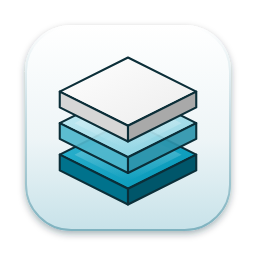
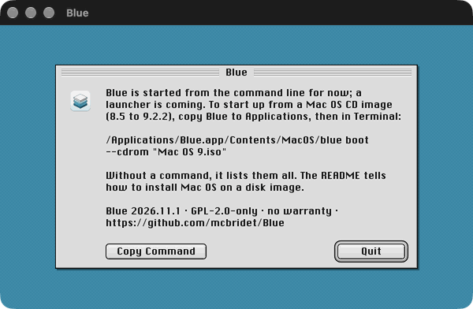
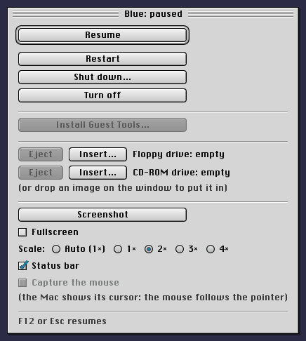
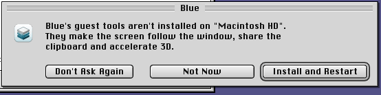

<p align="center">
  
</p>

<h1 align="center">Blue</h1>

<p align="center">
  <strong>Classic Mac OS on a native kernel.</strong><br>
  Mac OS 8.5 to 9.2.2 on today's Macs and Linux PCs: Apple's own code runs
  unmodified, on a native replacement for the Power Mac's NanoKernel instead
  of an emulated Power Mac.
</p>

<p align="center">
  <a href="https://mcbridet.github.io/Blue/">Website</a> ·
  <a href="https://github.com/mcbridet/Blue/releases/latest">Download</a> ·
  <a href="#quick-start">Quick start</a> ·
  <a href="#using-blue">Using Blue</a> ·
  <a href="#troubleshooting-and-faq">FAQ</a> ·
  <a href="#documentation">Documentation</a> ·
  <a href="#license">License</a>
</p>

<p align="center">
  <a href="https://github.com/mcbridet/Blue/actions/workflows/ci.yml"></a>
  <a href="https://github.com/mcbridet/Blue/releases/latest"></a>
  
  
  <a href="LICENSE"></a>
</p>

<p align="center">
  
</p>

## What Blue is

Blue runs classic Mac OS, from version 8.5 to 9.2.2, on a Mac or a Linux
PC of today. It doesn't emulate a whole Power Mac: it replaces the lowest
layer of Mac OS, the NanoKernel, with a native program, and runs
everything above it, Apple's own code, unmodified. To Mac OS, the machine
looks like an original iMac from 1998.

You bring the Mac OS: the Mac starts up from a Mac OS CD image, Mac OS's
own installer puts it on a disk image, and from then on the Mac starts up
from that disk, in a window on your desktop.

### Highlights

- **Mac OS 8.5 to 9.2.2,** unmodified, from their CDs or installed on a disk
  image. Blue starts the "Mac OS ROM" file from the startup disk, as the
  original iMac's firmware does.
- **Fast:** a PowerPC JIT on Apple silicon, ARM64 Linux and x86-64 (Intel
  from 2013, AMD from 2015), many times a real G3's speed.
- **3D:** QuickDraw 3D and RAVE through an engine games see as an ATI Rage
  128, and Mac OS 9's OpenGL through Blue's own libraries, drawn on the GPU
  (over Metal on Apple silicon) or in software.
- **The rest of a Mac:** sound and CD audio, networking through your
  connection, a folder of yours as a disk, the clipboard shared both ways,
  and disk, CD (`.iso`, `.toast`, `.cue`/`.bin`) and floppy images you drop
  on the window.
- **Guest tools,** offered once the Finder is up: the screen follows the
  window's size, the clipboard is shared, and the 3D engine, OpenGL and a
  library for Bandai Pippin titles are installed.
- **Reproducible runs** for testing and debugging: in instruction time, a run
  is the same every time, down to the instruction.

### How it works

On a real Power Mac, only the NanoKernel runs in the processor's
supervisor mode. The 68k emulator, the Toolbox, applications and drivers
all run in user mode and reach the kernel through a small interface. Blue
keeps all of that Apple code as it is and supplies everything below the
interface itself:

```
68k apps, 68k Toolbox code    → Apple's own 68k emulator (from the ROM, unchanged)
PPC apps, Toolbox, drivers    → Blue's user-mode PowerPC JIT and interpreter
══════ NanoKernel interface: kernel calls (twi, sc), exceptions, interrupts ══════
Native kernel + an iMac's devices + drivers + loader   ← Blue, portable C
macOS and Linux hosts, AArch64 and x86-64
```

[docs/architecture.md](docs/architecture.md) tells the whole story.

## Download and install

| Platform | Download |
|---|---|
| macOS, Apple silicon | [Blue-arm64.dmg](https://github.com/mcbridet/Blue/releases/latest/download/Blue-arm64.dmg) |
| macOS, Intel | [Blue-x86_64.dmg](https://github.com/mcbridet/Blue/releases/latest/download/Blue-x86_64.dmg) |
| Linux x86-64 | [Blue-x86_64.AppImage](https://github.com/mcbridet/Blue/releases/latest/download/Blue-x86_64.AppImage) |
| Linux AArch64 | [Blue-aarch64.AppImage](https://github.com/mcbridet/Blue/releases/latest/download/Blue-aarch64.AppImage) |

Each [release](https://github.com/mcbridet/Blue/releases) also has a
`SHA256SUMS` file with the downloads' checksums, the source code it was
built from, and `Blue-third-party-sources.tar.gz`: the exact sources of
the libraries the packages carry (SDL2, libslirp and GLib, with what they
need), as [THIRD-PARTY-NOTICES.md](THIRD-PARTY-NOTICES.md) describes.

### macOS

Blue needs macOS 11 (Big Sur) or later. Open the disk image for your Mac
(`Blue-arm64.dmg` for Apple silicon, `Blue-x86_64.dmg` for Intel) and drag
Blue to Applications.

The first time, macOS won't open Blue by double-clicking it. Blue is
signed ad hoc rather than by a registered Apple developer, and isn't
notarised, so macOS asks you to confirm it once:

- On macOS 14 and earlier, right-click (or Control-click) Blue in
  Applications and choose Open, then Open again.
- On macOS 15 and later, try to open it once, then go to System Settings >
  Privacy & Security, scroll down, and click Open Anyway next to the note
  about Blue.

After that it opens normally. If you prefer Terminal,
`xattr -dr com.apple.quarantine /Applications/Blue.app` does the same.

Blue runs from Terminal for now, as `/Applications/Blue.app/Contents/MacOS/blue`.
To type just `blue`, make a link to it in a folder on your `PATH`, for
example: `ln -s /Applications/Blue.app/Contents/MacOS/blue /usr/local/bin/blue`.

### Linux

The AppImages run on Linux with glibc 2.35 or later (Ubuntu 22.04, Debian
12, Fedora 36 and later): `Blue-x86_64.AppImage` for x86-64 PCs,
`Blue-aarch64.AppImage` for ARM64. Make yours executable, then run it as
Blue itself:

```sh
chmod +x Blue-x86_64.AppImage
./Blue-x86_64.AppImage --version
```

An AppImage mounts itself with FUSE, so it needs `fusermount` (the `fuse`
or `fuse3` package, which most desktops already have). Without FUSE, in a
container for example, add `--appimage-extract-and-run` before Blue's own
arguments: the AppImage then unpacks itself into a temporary folder each
time. Or unpack it once with `--appimage-extract` and run
`squashfs-root/AppRun` instead. AppImage integration tools, such as
AppImageLauncher and Gear Lever, can add Blue to your desktop's
applications.

### From source

You can also build Blue yourself: see
[Building from source](#building-from-source).

### Opening Blue from the desktop

If you double-click Blue.app or an AppImage, Blue shows a small window
rather than a Mac. For now, Blue is started from the command line, where
you tell it which disks and CDs to use. The window shows the command for
your copy of Blue, with a button that copies it, ready to paste into
Terminal.

A launcher is coming: a window for choosing the disks, CDs, memory and
shared folder, which remembers them between launches (see
[docs/roadmap.md](docs/roadmap.md)).

<p align="center">
  
</p>

## Quick start

Here's how to install Mac OS on a disk image and start it up. In the
commands below, `blue` stands for Blue's command:

| You have | Type this for `blue` |
|---|---|
| Blue.app on macOS | `/Applications/Blue.app/Contents/MacOS/blue` |
| An AppImage on Linux | `./Blue-x86_64.AppImage` (or `./Blue-aarch64.AppImage`) |
| Your own build | `build/blue` |

### What you need

- **A Mac OS CD image,** of version 8.5 to 9.2.2 (see
  [Compatibility](#mac-os-versions)): an `.iso`, `.toast`, `.cdr` or `.img`
  file, or a `.cue` sheet with its `.bin` files. Blue includes no Apple
  software, and needs no separate ROM file: it uses the "Mac OS ROM" file
  on the CD. To make an image of a CD you own, use Disk Utility on a Mac
  (File > New Image > Image from the disc, in the "DVD/CD master" format,
  which makes a `.cdr`), or `dd` on Linux.
- **About 2 GB of free space** for the Mac's disk.

### 1. Make a disk

```sh
blue disk create hd.img 2G "Macintosh HD"
```

This makes `hd.img`, a 2 GB disk image holding an empty Mac OS Standard
(HFS) volume called Macintosh HD. On most file systems the file only takes
up the space Mac OS fills. Blue won't overwrite a file that's already
there.

### 2. Install Mac OS

```sh
blue boot --disk hd.img --cdrom macos.iso --window --nvram blue.nvram
```

This starts the Mac in a window, with the new disk and the CD attached:

- `--disk hd.img` attaches the disk image, which Mac OS can write to.
- `--cdrom macos.iso` puts the CD image in a CD-ROM drive.
- `--window` shows the Mac in a window, running in real time.
- `--nvram blue.nvram` keeps the Mac's settings in a file (see
  [below](#keeping-your-settings)).

Blue starts up from the first drive that has a System Folder with a "Mac
OS ROM" file in it, in the order you gave them. The new disk is empty, so
the Mac starts up from the CD.

**Most Mac OS CDs:** open "Mac OS Install" on the CD and follow it.
Choose Macintosh HD as the destination, and when you reach the Install
screen, click **Options** and turn off **"Update Apple Hard Disk
Drivers"**: the driver updater only knows Apple's own drives, and fails
on Blue's. The installation takes a few minutes at most.

**Restore CDs,** which install with Apple Software Restore instead:
open Apple Software Restore from the CD's window. Click Switch Disk until
the destination is Macintosh HD, then Restore, and OK. This erases the
disk and copies Mac OS onto it (the disk then takes the restored
system's name). When it's done, click **Quit**, so that the Finder can
set the new disk up.
Drive Setup may open too, and list no drives: that's expected, and you
don't need it.

When the installation is over, choose **Shut Down** from Mac OS's Special
menu. Blue quits when the Mac turns itself off.

### 3. Start up from the disk

```sh
blue boot --disk hd.img --window --nvram blue.nvram
```

The disk now has a System Folder, so the Mac starts up from it. The first
time, Mac OS Setup Assistant asks a few questions. (While it's open, it
keeps one of your processor's cores busy, as it kept a real Mac's
processor busy; once it's finished, Blue goes back to resting while Mac OS
is idle.)

You can leave the CD attached if you like: the disk comes first on the
command line, so it stays the startup disk.

### 4. Install the guest tools

Once the Finder is up, Blue offers to install its guest tools on the
startup disk. Click **Install and Restart**: Mac OS writes the tools into
its Extensions folder and restarts, and from then on the screen follows
the window's size, the clipboard is shared, and 3D games are accelerated.
See [The guest tools](#the-guest-tools).

### Keeping your settings

`--nvram FILE` keeps the Mac's NVRAM in a file: the settings Mac OS keeps
in parameter RAM, and the startup disk chosen in the Startup Disk control
panel. Without it, the Mac starts each time with blank settings. Use the
same file every time you start a particular Mac, and give each
installation its own. Mac OS 9.1 and later write their settings when they
shut down or restart, so shut down from Mac OS to keep changes.

## Using Blue

### The window

The window shows the Mac's screen, with Blue's status bar below it. The
Mac runs in real time while the window is open, and rests when Mac OS is
idle.

To finish, shut down from Mac OS (Special > Shut Down): applications get
to save their work, the shared folder's changes are written back, and
Blue quits when the Mac turns itself off. Closing the window is like
pulling the plug: Blue stops at once, keeping NVRAM, but anything unsaved
in Mac OS is lost, and a shared folder's changes aren't written back.

### Blue's menu (F12)

<p align="center">
  
</p>

Press **F12** to open Blue's menu. The Mac pauses while the menu is open;
F12 or Esc closes it again.

- **Resume** closes the menu.
- **Restart** restarts the Mac at once, like its reset button: anything
  unsaved in Mac OS is lost.
- **Shut down…** presses the Mac's power key, so Mac OS asks whether to
  shut down, and does it properly if you say so.
- **Turn off** turns the Mac off at once, like its power switch, for a Mac
  that has stopped responding. NVRAM is kept.
- **Install Guest Tools…** offers the [guest tools](#the-guest-tools)
  again, whenever there's something to install.
- **The drives:** each floppy and CD-ROM drive shows what's in it, with
  **Eject** and **Insert…** buttons (see
  [Disks, CDs and floppies](#disks-cds-and-floppies)).
- **Screenshot** saves the Mac's screen as a PNG on your Desktop.
- **Fullscreen** fills your display with the Mac.
- **Scale** sets how big the Mac's pixels are (see
  [Screen size and scale](#screen-size-and-scale)).
- **Status bar** shows or hides the status bar.
- **Capture the mouse** sets whether the mouse is captured while Mac OS
  hides its pointer, as games do (see [Keyboard and mouse](#keyboard-and-mouse)).

While the menu is open, the Mac's clock stops, so it's behind by that
much afterwards.

### The status bar

The status bar has a light for each of the Mac's parts, and what each is
doing:

- **CPU** glows green as the Mac works and soft blue while it rests, and
  shows the Mac's speed, as the clock rate of a G3 that would keep up.
- **Disk**, **CD-ROM** and **Floppy** light up as they read (green) and
  write (amber), with how many bytes a second they move.
- **Network** lights up as the Mac sends and receives, in bits a second.

A dimmed light means there's no such device, and "F12: menu" on the
right is a reminder of where the menu is. `--no-status-bar` starts
without the status bar; the menu brings it back.

### The guest tools

Some things only code inside Mac OS can do, so Blue comes with guest tools
that it installs there for you:

| Guest tool | What it does |
|---|---|
| Blue Enhancements | The screen follows the window's size, and the clipboard is shared with your computer. |
| Blue 3D Engine | Accelerates QuickDraw 3D and RAVE games, which see an ATI Rage 128. |
| Blue OpenGL Library, Memory and Utility | OpenGL for Mac OS 9 games, drawn on your GPU. |
| Blue Pippin Library | Lets Bandai Pippin titles run (see [Pippin titles](#pippin-titles)). |

When the Finder is up and a tool is missing, or comes from another
version of Blue, Blue offers to install them, over the Mac's screen:

<p align="center">
  
</p>

- **Install and Restart** (or **Update and Restart**) writes the tools
  into the System Folder's Extensions folder and restarts Mac OS, as
  Special > Restart does: applications may ask to save their work first.
  CDs and floppies stay in their drives.
- **Not Now** leaves them for now: Blue asks again the next time Mac OS
  starts up.
- **Don't Ask Again** stops the offer for that disk. Blue remembers it in
  a "Blue Preferences" file in the disk's Preferences folder; Install
  Guest Tools… in Blue's menu still offers them.

Mac OS 9 comes with OpenGL libraries of Apple's under the same names, so
when Blue's are installed, Apple's move to Extensions (Disabled). If you
delete Blue's later, Blue offers to put Apple's back.

Blue doesn't offer the tools when the startup disk is a CD, or can't be
written. To install them by hand instead, make a disk of them with
`blue tools create tools.img`, attach it with `--cdrom tools.img`, drag
its files onto the System Folder, and restart.

### Screen size and scale

With Blue Enhancements installed, the Mac's screen follows the window:
resize the window, or make it full screen, and Mac OS changes its
resolution to fill it once you let go. Without it, the screen keeps the
resolution chosen in Mac OS's Monitors & Sound control panel (640 × 480 to
1280 × 1024), and the window scales it to fit.

The **scale** is how many of your display's pixels make one of the Mac's,
from 1 to 4. **Auto**, the default, makes Mac OS about as big on your
display as on a 1999 Mac's screen (about 80 pixels to the inch), from
your display's size and resolution: 1× on a typical 27-inch 1440p
display, 2× on a 4K one, 3× on a 5K iMac or a 14-inch MacBook Pro. If
Mac OS looks too small or too big, choose another scale in the menu, or
start with `--scale 2` (or `auto`, `1`, `3`, `4`). `--integer-scale` keeps
the picture crisp, with a border if need be, where the window would
otherwise scale the screen by a fraction.

### Keyboard and mouse

| Mac key | On a Mac keyboard | On a PC keyboard |
|---|---|---|
| Command (⌘) | Command | Windows or Super |
| Option (⌥) | Option | Alt |
| Control | Control | Ctrl |

Command-key shortcuts go to Mac OS, as on a Mac. F12 is Blue's: it opens
the menu, and Mac OS never sees it. (On a Mac laptop, you may need to hold
fn as you press F12.)

On macOS, Blue's own menu bar has a few Command-key shortcuts of its own,
which act on Blue as well as reaching Mac OS: **Command-Q** quits Blue
and **Command-W** closes its window (both at once, as if you pulled the
plug), Command-H hides Blue and Command-M minimises its window. Choose
Quit and Close from Mac OS's File menu instead.

The Mac has a one-button mouse: the left button is its button, and the
others, and the scroll wheel, do nothing. For a contextual menu,
Control-click.

The Mac's pointer follows yours. When Mac OS hides its pointer for a
moment, as games do, Blue captures the mouse, so that its movements go to
the game; the window's title says so. Press **Control-Option**
(Ctrl+Alt) to get your pointer back, and click in the window to capture
it again. Capture the mouse in the menu turns this off.

### Copy and paste

With Blue Enhancements, the clipboard is shared both ways: text you copy
in Mac OS can be pasted on your computer, and text you copy on your
computer is what Command-V pastes in Mac OS. Only text is shared, not
styles or pictures, up to 4 MB. Characters that Mac OS's own character set
lacks reach Mac OS 9's Unicode-aware applications as they are, and
others as the closest match (½ as "1/2", for example) or "?".

### Disks, CDs and floppies

The Mac has up to four drives for disks and CDs (a shared folder takes
one of them), and a floppy drive:

| Option | Gives the Mac |
|---|---|
| `--disk FILE` | A disk. Mac OS can write to it if you can write to the file. |
| `--cdrom FILE` | A CD-ROM drive, with that disc in it (read-only). |
| `--floppy FILE` | The floppy drive, with that disk in it. |

In a window there's always a floppy drive, and a CD-ROM drive if you
didn't give one, so you can put discs in later. Blue tries the drives
for startup in the order you give them.

**Putting a disc in:** drop its image on the window, or click Insert… for
a drive in Blue's menu and choose it. A floppy-sized image (2880K or
smaller) goes in the floppy drive, and anything else in a CD-ROM drive.
Mac OS sees it go in as on a real Mac, so an installer waiting for its
next disc carries on. On Linux, Insert… needs zenity or kdialog.

**Several floppies:** give `--floppy` once for each disk of a set. The
first is in the drive at startup, and each time Mac OS ejects one, the
next goes in a moment later, so a multi-disk installer just carries on.
The menu shows what's still to come.

**Ejecting:** eject discs from Mac OS, as on any Mac: drag a disc to the
Trash, or select it and choose Put Away from the File menu or Eject from
the Special menu. Blue's menu can only eject a disc that Mac OS isn't
using. Discs and floppies stay in their drives when Mac OS restarts, as
in a real iMac.

**The startup disk:** Mac OS 9.1 and later choose it in the Startup Disk
control panel, as on a real Mac; keep NVRAM with `--nvram` so the choice
lasts. Mac OS 8.5 and 8.6 start up from the first drive with a System
Folder, and their Startup Disk lists only the current one. A CD you put
in while the Mac is running is never the startup disk.

**Images Blue takes:**

- **CDs:** `.iso`, `.toast`, `.cdr` and `.img` files (raw images of HFS or
  ISO 9660 discs), and cue sheets: a `.cue` file with its `.bin`, WAVE or
  AIFF tracks. Audio CDs and games' soundtracks need the cue sheet: give
  Blue the `.cue` file, not the `.bin`. `blue disk toc FILE` lists a
  disc's tracks. Compressed images and `.dmg` files aren't taken: on a
  Mac, `hdiutil convert image.dmg -format UDTO -o image` makes a raw
  `.cdr` from a `.dmg`.
- **Floppies:** raw images of 400K, 720K, 800K, 1440K and 2880K disks
  (`.img`, `.dsk`, `.ima`, `.flp`), and Disk Copy 4.2 images (`.image`).
  Convert other kinds first, with Disk Copy in Mac OS or a tool on your
  computer. `blue disk create blank.img 1440K "Untitled"` makes a blank,
  formatted floppy.
- **Disks:** raw disk images, with an Apple partition map or a bare
  volume, as `blue disk create` makes.

Mac OS writes to a disk as soon as it mounts it. To keep a floppy or disk
image as it is, lock it in the Finder, or make the file read-only: Mac OS
then shows the disk as locked.

### The shared folder

```sh
blue boot --disk hd.img --share ~/Mac --window --nvram blue.nvram
```

`--share FOLDER` shows a folder on your computer to Mac OS as a disk of
its own, named after the folder. It's the easiest way to move files
between your computer and the Mac: put a downloaded program in the
folder, and install it from the disk in Mac OS.

Changes cross over once per run, in each direction:

- Files you add to the folder while the Mac runs appear in Mac OS the next
  time you start it.
- What Mac OS changes on the disk is written back to the folder when Mac
  OS shuts down (or you put the disk away). If Blue stops without that,
  because you closed the window or turned the Mac off, nothing is written
  back, and anything that had changed is kept as a disk image in the
  folder's `.blue-recovery` folder instead.

Blue never destroys your files: a file that Mac OS deleted or replaced is
moved to `.blue-recovery` inside the folder, under the date and time, and
if a file changed on both sides, Mac OS's version is kept beside yours as
`name (Mac OS).ext`. Blue lists what it wrote back.

Resource forks and Finder information (type and creator) are kept: on
macOS in the files themselves, and on Linux in AppleDouble `._name`
files. Files without them get a type from their extension. Files whose
names start with a dot, links to folders and files larger than 2 GB are
left out, and long names are shortened, as Mac OS 9 shortens them. More
in [docs/shared-folder.md](docs/shared-folder.md).

### Networking

In a window, the Mac's built-in Ethernet reaches the internet through
your computer's connection. Mac OS gets its address by DHCP, so TCP/IP
works as soon as it's turned on. On Mac OS 8.5, it starts out inactive:
open the TCP/IP control panel, click Yes to make it active, then close the
panel and save.

The Mac can connect out, but nothing outside can connect in, and only IP
gets through: AppleTalk and file sharing between Macs don't. Browsers of
the time can't open most of today's secure (HTTPS) sites, though plain
HTTP sites work. `--no-net` leaves the Ethernet unplugged.

Blue's network uses libslirp, which Blue.app and the AppImages carry. A
build of your own needs it installed (see
[Building from source](#building-from-source)).

### Sound

Sound plays while the Mac runs in a window, through Mac OS's own sound
driver, and follows Mac OS's volume and mute (in the Monitors & Sound or
Sound control panel, or the Control Strip). CD audio, from an audio CD's
or a game's cue sheet, plays through the same chip and follows the same
volume, as on the iMac; AppleCD Audio Player, in the Apple menu, plays
audio CDs. `--no-sound` turns sound off.

### 3D graphics

With the guest tools installed, games that use QuickDraw 3D or RAVE draw
with Blue 3D Engine, and games that use OpenGL draw with Blue's OpenGL
libraries. Both draw on your computer's GPU, through OpenGL 3.3 (over
Metal on Apple silicon), or in software if there's no GPU to use, or with
`--no-gpu`. Install what a game needs from Mac OS as on a real Mac, such
as QuickDraw 3D, Game Sprockets or URL Access. Frames come at most 60 a
second, as on the iMac's display, which keeps games of the time at their
proper speed.

### Pippin titles

Many discs for the Bandai Pippin, Apple's 1996 game console design, run
in Blue. Titles that need the Pippin's own library get Blue Pippin
Library, one of the guest tools. Their saved games and preferences go in
`System Folder:Preferences:Pippin:`, under the title's name. The Pippin's
AppleJack controller isn't emulated: titles map its buttons to keys. More
in [docs/software.md](docs/software.md#pippin-titles).

## Command-line reference

Blue's commands:

| Command | What it does |
|---|---|
| `blue boot [OPTIONS]` | Starts the Mac (see the options below). |
| `blue disk create FILE SIZE [NAME]` | Makes a disk image holding an empty HFS volume. `SIZE` is in bytes, or with `K`, `M` or `G`: 1M or more, or a floppy's size (400K, 720K, 800K or 1440K). The name is Macintosh HD, or Untitled for a floppy, unless you give one. |
| `blue disk toc FILE` | Lists a CD image's tracks, as its CD-ROM drive gives them to Mac OS. |
| `blue tools create FILE` | Makes a disk of the guest tools, to install them by hand (attach it with `--cdrom`). |
| `blue rom info FILE` | Describes a Mac OS ROM file, or the one in a disk or CD image's System Folder. |
| `blue rom config FILE` | Shows the ROM's NanoKernel configuration and memory map. |
| `blue rom parcels FILE` | Lists the parcels of a Mac OS 9.1 or later ROM file. |
| `blue rom extract FILE OUT` | Writes the ROM's 4 MB Toolbox image. |
| `blue rom trampoline FILE OUT` | Writes the ROM file's Trampoline (an ELF file). |
| `blue run-raw FILE ADDR [N]` | For developers: loads raw PowerPC code at hex address `ADDR` in 64 MB of memory, runs it for at most `N` instructions (100 million unless you say), and shows the registers. |
| `blue --version` | Shows Blue's version, and which SDL2 and libslirp it found. |
| `blue` | Lists the commands and options. |

The options of `blue boot`:

**Drives and memory**

| Option | What it does |
|---|---|
| `--disk FILE` | Attaches a disk image, writable if the file is. |
| `--cdrom FILE` | Attaches a CD image, read-only, in a CD-ROM drive. |
| `--cdrom-drive` | Adds an empty CD-ROM drive. (A window, or `--realtime`, has one anyway, unless four drives are taken.) |
| `--floppy FILE` | Puts a floppy image in the floppy drive; give it again for each disk of a set, up to 16. |
| `--floppy-drive` | Adds an empty floppy drive. (A window, or `--realtime`, has one anyway.) |
| `--share FOLDER` | Shows a folder on your computer as a disk (one folder). |
| `--nvram FILE` | Keeps the Mac's NVRAM (settings, the startup disk) in this file. |
| `--ram MB` | The Mac's memory, from 8 to 1024 MB (128 unless you say). |
| `--rom FILE` | Starts this ROM file, or 4 MB ROM image, instead of the startup disk's. |

Up to four drives in all can be disks, CD-ROM drives or the shared folder.

**The window**

| Option | What it does |
|---|---|
| `--window` | Shows the Mac in a window, in real time, until you close it or the Mac turns off. |
| `--scale auto\|1\|2\|3\|4` | How many of the display's pixels make one of the Mac's (Auto unless you say). |
| `--integer-scale` | Scales the screen by whole numbers only: crisp, with a border if need be. |
| `--no-status-bar` | Starts without the status bar. |
| `--no-sound` | Doesn't play the Mac's sound. |
| `--no-net` | Leaves the Mac's Ethernet unplugged. |
| `--no-gpu` | Draws 3D in software rather than on the GPU. |

**Time and speed**

| Option | What it does |
|---|---|
| `--realtime` | Runs in real time without a window. |
| `--instruction-time` | With `--window`, counts time in instructions, as without a window. |
| `--no-idle` | Keeps running flat out while Mac OS is idle, rather than resting. |
| `--no-fast-start` | Doesn't hurry through the timeouts of startup. |
| `--interp` | Interprets the PowerPC code, without the JIT. |
| `--seconds S` | Stops after `S` seconds of your computer's time. |
| `--max N` | Stops after `N` instructions (without a window, 500 million unless you say). |
| `--fixed-time T` | Starts the Mac's clock at Unix time `T` rather than now. |

**Testing and debugging**

| Option | What it does |
|---|---|
| `--input FILE` | Plays scripted input: clicks, keys, discs and more at given instruction counts. |
| `--screenshot FILE.png` | Saves the screen when the run ends. |
| `--dump-ram FILE` | Saves the Mac's memory when the run ends. |
| `--trace`, `--trace-from N`, `--trace-reg R`, `--trace-range LO:HI`, `--trace-insn WORD` | Logs the instructions run. |
| `--watch ADDR` | Logs every write to the page holding `ADDR`. |
| `--traps N`, `--traps-after N` | Logs the first `N` 68k traps. |
| `--log-hostcalls` | Logs the requests Blue's drivers handle. |
| `--io-ram` | Treats unknown device addresses as plain memory. |

Without `--window` or `--realtime`, a run counts time in instructions, so
it's the same every time: see [docs/debugging.md](docs/debugging.md),
which also lists the `BLUE_*` environment variables.

## Compatibility and limits

### Mac OS versions

| Mac OS | Works | Notes |
|---|---|---|
| 8.5 | Yes | TCP/IP starts out inactive. |
| 8.6 | Yes | Includes URL Access, which some programs need. |
| 9.0 to 9.0.4 | Yes | |
| 9.1 | Yes | |
| 9.2 to 9.2.2 | Yes | |

Each starts up from its CD and installs onto a disk image. Blue's machine
is an original iMac, which covers Mac OS from 8.5 to 9.2.2. Earlier
versions aren't supported, and Mac OS X, which has no NanoKernel, can't
run on Blue.

### Your computer

| Computer | Blue runs on | Speed |
|---|---|---|
| Mac with Apple silicon | macOS 11 or later | JIT |
| Mac with an Intel processor | macOS 11 or later | JIT on most Macs from 2013 on |
| PC with an x86-64 processor | Linux with glibc 2.35 or later (the AppImage) | JIT on most processors from 2013 (Intel) or 2015 (AMD) on |
| ARM64 computer | Linux with glibc 2.35 or later (the AppImage) | JIT |

The JIT translates PowerPC code into your processor's, which makes Blue
many times faster than a real G3. On x86-64 it needs the x86-64-v3
features (AVX2, FMA3, BMI1 and 2, LZCNT and MOVBE), which Intel's Core
processors have from Haswell (2013) and AMD's from Excavator (2015), but
some Pentium, Celeron and Atom processors lack. Without them, Blue says
what's missing and interprets the code instead: slower, but it still
works. On a Mac with Apple silicon, use `Blue-arm64.dmg`: the Intel
version runs in Rosetta 2 without the JIT.

### What isn't there

Blue doesn't have everything a real iMac had, yet:

- **AltiVec,** the G4's vector instructions: programs that need a G4
  don't run.
- **Mac OS's virtual memory,** which stays off: give the Mac more memory
  with `--ram` instead.
- **Modems, serial ports, infrared and printing.**
- **Game controllers** (joysticks and gamepads), and USB or FireWire
  devices of any kind: the keyboard and mouse are the Mac's input.
- **Sound input** (a microphone), and 3D sound.
- **AppleTalk** networking, and connections into the Mac.
- **3dfx Glide,** for games that draw with a Voodoo card.
- **Old World Macs:** Blue is an original iMac, and can't start the ROMs
  of earlier Power Macs or 68k Macs.

[docs/future.md](docs/future.md) has ideas for most of these, and
[docs/roadmap.md](docs/roadmap.md) what's next.

## Troubleshooting and FAQ

### macOS won't open Blue

Blue isn't notarised, so macOS asks you to confirm it the first time: see
[macOS](#macos) under Download and install. If macOS says the app is
damaged, `xattr -dr com.apple.quarantine /Applications/Blue.app` in
Terminal clears the download's quarantine.

### The AppImage won't run

Check that it's executable (`chmod +x`). If it says it can't mount itself,
your system lacks FUSE: install the `fuse` or `fuse3` package, or run it
with `--appimage-extract-and-run` before Blue's arguments. See
[Linux](#linux).

### Double-clicking Blue only shows a small window

That's expected for now: Blue is started from the command line. The
window shows the command to use. See
[Opening Blue from the desktop](#opening-blue-from-the-desktop).

### Mac OS won't start from my CD

- Blue says "no drive has a System Folder with a Mac OS ROM file in it":
  the image isn't a startup CD of Mac OS 8.5 to 9.2.2. Update CDs and
  other programs' CDs can't start the Mac.
- Blue refuses the image: it's compressed, a `.dmg`, or a `.bin` without
  its `.cue`. See [Images Blue takes](#disks-cds-and-floppies).
- Attach CDs with `--cdrom`, not `--disk`: the Mac OS 8.5 CD won't start
  from a drive it can write to.
- If you used `--rom`, leave it out: Blue then uses the CD's own ROM file,
  which is the one that version of Mac OS needs.

### The installer stops, or complains about drivers

Turn off "Update Apple Hard Disk Drivers" in the installer's Options (see
[Install Mac OS](#2-install-mac-os)). Drive Setup lists no drives: that's
expected, and you don't need it.

### There's no menu bar after restoring Mac OS 9.2.2

If Blue closed before Apple Software Restore finished (you didn't click
its last Quit), the new disk has no Desktop Folder yet, and quitting the
Setup Assistant leaves the desktop without a menu bar. Restart: the Finder
has made the folder by then, and the next startup is as it should be.

### Mac OS is tiny, or huge

Choose another Scale in Blue's menu (F12), or start with `--scale`. See
[Screen size and scale](#screen-size-and-scale).

### There's no sound

Sound plays only with `--window` (and not with `--no-sound`). Check Mac
OS's own volume and mute, in the Monitors & Sound or Sound control panel.
For a CD's music, attach the `.cue` file of a cue sheet image: a plain
`.iso` has no audio tracks.

### The network doesn't work

- The network runs only with `--window` or `--realtime`, and not with
  `--no-net`.
- In your own build, Blue needs libslirp: `blue --version` says whether
  it found it.
- On Mac OS 8.5, make TCP/IP active (see [Networking](#networking)).
- Most of today's websites need HTTPS, which browsers of the time can't
  manage: plain HTTP sites work. AppleTalk doesn't work, and nothing can
  connect in to the Mac.

### Blue says "no JIT"

Your processor lacks what the JIT needs (on x86-64, the x86-64-v3
features), and Blue says what's missing. Blue still runs, by interpreting
the code, but more slowly. See [Your computer](#your-computer).

### Blue keeps a processor core busy

Mac OS Setup Assistant never rests while it's open: finish or quit it.
Otherwise an idle Mac costs only a few percent of one core.

### Where do screenshots go?

On your Desktop, as `blue` followed by the date and time (in the folder
Blue was started from, if there's no Desktop). `--screenshot FILE.png`
saves one when a run ends.

### F12 doesn't open the menu

On a Mac laptop, hold fn as you press F12, or set the function keys to
work as standard function keys in System Settings > Keyboard. In your
own build, the menu needs SDL 2.0.18 or later: with an older SDL, F12
only pauses the Mac.

### Blue quit when I pressed Command-Q (or Command-W)

On macOS, Blue's own menu bar takes Command-Q, Command-W, Command-H and
Command-M as well as Mac OS (see [Keyboard and mouse](#keyboard-and-mouse)):
use Mac OS's File menu to quit applications and close windows.

### My mouse is stuck in the window

Press Control-Option (Ctrl+Alt), or switch to another application. Click
in the window to capture the mouse again.

### The CD came out when Mac OS restarted

It shouldn't any more: discs and floppies now stay in their drives through
a restart, as in a real iMac. If one came out, Mac OS ejected it (with Put
Away, the Trash, Eject, or an installer).

### A disc I dropped didn't go in

Blue's menu opens to say why: there's no empty drive, the drive's disc is
in use by Mac OS (eject it from Mac OS first), or the image isn't one Blue
takes (see [Disks, CDs and floppies](#disks-cds-and-floppies)). If all
four drives are taken by disks and CDs, there's no spare CD-ROM drive.

### My changes in the shared folder didn't reach my computer

Changes are written back when Mac OS shuts down, not when you close the
window. If Blue stopped without a shutdown, look in the folder's
`.blue-recovery` folder. See [The shared folder](#the-shared-folder).

### Mac OS forgot my settings, or my startup disk

Start with the same `--nvram` file each time, and shut down from Mac OS:
Mac OS 9.1 and later write their settings when they shut down or restart.

### Blue doesn't offer the guest tools, or I want it to stop

Blue offers them only in a window, and only on a startup disk Mac OS can
write to. If you chose Don't Ask Again, Install Guest Tools… in Blue's
menu still offers them. To stop the offer, choose Don't Ask Again.

### An application says there isn't enough memory

Mac OS's virtual memory stays off in Blue. Give the Mac more memory with
`--ram` (up to 1024 MB), and the application more in its Get Info window.

### StuffIt archives won't open on Mac OS 8.5 or 8.6

Most archives from 1998 on need StuffIt Expander 5 or later, and 8.5 and
8.6 come with 4.5, which quits without a word. Install Expander 5.5, or
expand the archive on your computer with The Unarchiver's `unar`, which
keeps the files' resource forks on macOS for the shared folder.

### The Mac's clock is a little out

While Mac OS starts up, Blue runs its clock fast to hurry through the
timeouts of startup, so the clock is 15 to 25 seconds ahead at first, and
right again after a minute or two of the Mac resting. While Blue's menu is open, the clock stops.

## Building from source

Blue builds with a C11 and C++17 compiler (Clang or GCC) and `make`, on
macOS and Linux:

```sh
git clone https://github.com/mcbridet/Blue
cd Blue
make            # builds build/blue
make test       # runs the unit tests
```

Blue loads SDL2 (the window, sound and input) and libslirp (the network)
when it runs, so they aren't needed to build it, but you'll want them to
use it: `brew install sdl2 libslirp` on macOS, or your distribution's
SDL2 and libslirp packages on Linux.

`make app` and `make dmg` make Blue.app and its disk image on macOS, and
`make appimage` an AppImage on Linux. [docs/building.md](docs/building.md)
has the details: the tests, CI, packaging and releases.

## Documentation

The [docs](docs/README.md) folder goes further:

- [How Blue works](docs/architecture.md), and how Mac OS 8.5 to 9.2.2
  [were brought up](docs/bring-up.md) on it.
- [The iMac's devices](docs/devices.md), [the drives](docs/drives.md),
  [the shared folder](docs/shared-folder.md), [the window](docs/window.md)
  and [the guest tools](docs/guest-tools.md), in depth.
- [The JIT](docs/jit.md).
- [Notes on programs and games](docs/software.md).
- [Building, testing and packaging](docs/building.md),
  [testing and debugging](docs/debugging.md), and
  [the source layout](docs/layout.md).
- [The QEMU reference](docs/qemu-reference.md) and
  [NanoKernel 2 under QEMU](docs/nk2-reference.md).
- [The roadmap](docs/roadmap.md), [the plan](docs/plan.md) with its
  findings, [ideas for later](docs/future.md), and the plans for
  [OpenGL](docs/opengl-plan.md), [the GPU backend](docs/gpu-plan.md),
  [Glide](docs/glide-plan.md) and [the x86-64 JIT](docs/x86-jit-plan.md).

## License

Blue is free software: you can redistribute it and/or modify it under the
terms of the GNU General Public License, version 2 only (GPL-2.0-only), as
published by the Free Software Foundation. It comes with no warranty: see
[LICENSE](LICENSE). The code it includes or bundles from others, and their
licences, are listed in [THIRD-PARTY-NOTICES.md](THIRD-PARTY-NOTICES.md).
Blue includes no Apple software, and isn't affiliated with Apple.

## Acknowledgements

Blue stands on other people's careful work:

- **Elliot Nunn's reverse engineering** of the Power Mac ROM:
  [NanoKernel](https://github.com/elliotnunn/NanoKernel) (NanoKernel 1),
  [powermac-rom](https://github.com/elliotnunn/powermac-rom) (NanoKernel 2:
  its tasks and the blue task, scheduler, Multiprocessing Services calls and
  objects) and [tbxi](https://github.com/elliotnunn/tbxi) (the ROM file's
  parcels). Blue's kernel is its own code, written to the interfaces and
  behaviour these document.
- **[QEMU](https://www.qemu.org) and [OpenBIOS](https://github.com/openbios/openbios),**
  whose `mac99` machine runs Apple's real NanoKernel 2: Blue's was checked
  against it ([docs/nk2-reference.md](docs/nk2-reference.md)). Blue's
  networking uses QEMU's [libslirp](https://gitlab.freedesktop.org/slirp/libslirp).
- **[SheepShaver and Basilisk II](https://github.com/cebix/macemu),** which
  showed long ago that classic Mac OS can run on a host kernel.
- **[Mesa](https://mesa3d.org),** the reference Blue's OpenGL is tested
  against, and SGI's OpenGL Utility library, which Blue's follows.
- **[SDL](https://www.libsdl.org)** and **[Dear ImGui](https://github.com/ocornut/imgui)**
  (Omar Cornut) for the window, and **Robin Casady's ChicagoFLF**, after
  Susan Kare's Chicago, for its menus.
- **Apple's own documentation:** Inside Macintosh, the technotes and
  developer notes, and the headers published with Darwin.

Blue was called syshm until November 2026. Its settings in the environment
are `BLUE_*` now: if one of the old names is set, Blue says what it's
called now, and doesn't read it.
